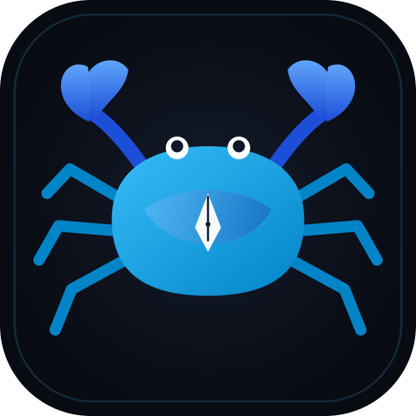

<p align="center">
  
</p>

<h1 align="center">Krebs</h1>

<p align="center">
  <strong>Portable Minimalist Writing & Whiteboard Studio with Local Hermes AI</strong><br>
  <em>"No vaults, no plugins, just you, the words, the canvas, and your private AI."</em>
</p>

<p align="center">
  
  
  
  
  
  
</p>

---

## 🌟 Overview

**Krebs** is a blazingly fast, GPU-accelerated desktop writing studio and freehand whiteboard built in **100% pure Rust** (`iced` 0.13 + `wgpu`). It combines distraction-free typing, live Markdown split rendering, tablet stylus ink drawing, bidirectional trilingual text shaping (English, German, Persian), and a **private local Hermes AI Essay Coach** that evaluates your drafts on your own hardware with zero cloud telemetry.

---

## ⚡ 1-Command Universal Installation

Install Krebs Studio and set up the **`krabbe`** terminal command in one copy-paste line:

### 🐧 Linux & 🍏 macOS
```bash
curl -fsSL https://raw.githubusercontent.com/ybreakless/Krebs/main/install.sh | bash
```

### 🪟 Windows (PowerShell)
```powershell
irm https://raw.githubusercontent.com/ybreakless/Krebs/main/install.ps1 | iex
```

> **Instant Terminal Launch:** Once installed, launch Krebs from any terminal (PowerShell, Command Prompt, Bash, Zsh) simply by typing:
> ```bash
> krabbe              # Open Krebs Writing & Whiteboard Studio
> krabbe notes.md     # Open or create a Markdown document directly
> ```

---

## 📦 Multi-Platform Downloads & Packages

Prebuilt releases for every major platform and package manager are available on the [**GitHub Releases**](https://github.com/ybreakless/Krebs/releases) page — the [**Download page**](https://ybreakless.github.io/Krebs/download) auto-detects your platform and links the right package.

### 🐧 Linux Packages & Flatpak & AUR
| Distribution / Package Manager | Package / Command |
|---|---|
| **Universal Linux (AppImage)** | `chmod +x krebs-v*-x86_64.AppImage && ./krebs-v*-x86_64.AppImage` |
| **Universal Linux (Flatpak)** | `flatpak install ./krebs-v*-linux.flatpak` |
| **Ubuntu / Debian / Linux Mint (APT)** | Download `.deb` & run: `sudo apt install ./krebs_*_amd64.deb` |
| **Fedora / RHEL / CentOS (DNF)** | Download `.rpm` & run: `sudo dnf install ./krebs-*.x86_64.rpm` |
| **Arch Linux / Manjaro (Pacman)** | Download `.pkg.tar.zst` & run: `sudo pacman -U ./krebs-*.pkg.tar.zst` |
| **AUR (prebuilt)** | `yay -S krebs-bin` — or build from source with `yay -S krebs` |
| **Standalone Tarball (All Distros)** | Download `krebs-v*-x86_64-unknown-linux-gnu.tar.gz` and run `./krabbe` |

### 🪟 Windows Packages
| Type | Package |
|---|---|
| **Windows x64 — Setup Wizard (no admin rights)** | `krebs-v*-x64-setup.exe` *(recommended)* |
| **Windows x64 — Portable ZIP** | `krebs-v*-x86_64-pc-windows-msvc.zip` |
| **Windows x86 — Portable ZIP (32-bit)** | `krebs-v*-i686-pc-windows-msvc.zip` |
| **Windows ARM64 — Portable ZIP (Surface / Snapdragon X)** | `krebs-v*-aarch64-pc-windows-msvc.zip` |

> *Run the setup wizard, or extract a zip and start `Krebs.exe` directly — your notes and settings live next to the program (true portability). `install.ps1` remains available for PATH + shortcut registration.*

### 🍏 macOS Packages
| Package Type | Architecture / Compatibility |
|---|---|
| **Universal Installer Disk Image (.dmg)** | `krebs-v*-macos-universal.dmg` *(Apple Silicon M1/M2/M3/M4 & Intel)* |
| **Universal Application Bundle (.zip)** | `krebs-v*-macos-universal.zip` |
| **Apple Silicon Standalone Binary (.tar.gz)** | `krebs-v*-aarch64-apple-darwin.tar.gz` |
| **Intel Mac Standalone Binary (.tar.gz)** | `krebs-v*-x86_64-apple-darwin.tar.gz` |

> *Open `krebs-v*-macos-universal.dmg` and drag `Krebs.app` to your `/Applications` folder. Symlinks to `/usr/local/bin/krabbe` allow direct terminal launching.*

---

## 🚀 Key Features

### 1. 📝 Writing Studio with Live Split Markdown
- **Live Markdown Formatting (`Ctrl+1`, `Ctrl+2`, `Ctrl+3`):**
  - **Edit Mode (`Ctrl+1`):** Pure distraction-free monospace editor.
  - **Live Split (`Ctrl+2`):** Simultaneous typing and live rendered preview with real bold (`**bold**`), italic (`*italic*`), blockquotes, code chips, and headings.
  - **Reader (`Ctrl+3`):** Clean reading view.
- **Adjustable Writing Width (`Ctrl+W`):**
  - Cycle between **Standard** (85ch), **Wide** (130ch / 1350px - default), and **Full Width** (100% screen fill).
- **In-Document Search (`Ctrl+F`):**
  - Instant floating search bar with match counter (`"Match 2 of 5"`), Next (`Enter` / `↓`), Previous (`↑`), and line jumping.
- **Offline Retro & Editorial Fonts:**
  - Integrated with **JetBrains Mono**, **IBM Plex Mono**, **VT323 (CRT Retro)**, and **Vazirmatn (Persian RTL)**.
- **Trilingual BiDi Engine:**
  - Automatic per-paragraph RTL (Persian/Farsi) and LTR (English/German).
  - Persian ZWNJ (Zero-Width Non-Joiner) via `Shift + Space` and `Ctrl + Shift + 2`.
  - German Umlaut chords (`Alt + a/o/u/s`).

---

### 2. ✨ Hermes AI Essay Coach & Writing Agent
- **100% Private, Local-First AI:**
  - Designed to work alongside your writing with local models like **Nous Research Hermes 3** (`hermes3`), Llama 3, or any OpenAI-compatible endpoint (`http://localhost:11434/v1` via Ollama, LM Studio, or vLLM).
  - **Zero Telemetry:** Your essays and drafts never leave your device.
- **Academic Essay Tools:**
  - 🎯 **Grade Essay:** Comprehensive academic scorecard (0-100 score, CEFR B2/C1 band rating, quantitative metrics, structure analysis, and concrete recommendations).
  - 💡 **Writing Tips:** Actionable structural feedback, opening hook diagnostic, and paragraph cohesion.
  - 🔍 **Fix Grammar & Flow:** Sentence length variance, passive voice checks, and stylistic polishing.
  - 🇩🇪 **German B2/C1 Polish:** Identifies missing connectors and suggests idiomatic Goethe/Telc Redemittel.
- **Built-in Offline Heuristic Fallback:**
  - If Ollama is offline or unreachable, Krebs automatically runs the built-in offline linguistic evaluator to give you immediate scorecard feedback without network errors!
- **One-Click Actions:**
  - `[ 📋 Copy Feedback ]` copies the critique to your clipboard.
  - `[ ➕ Insert at Cursor ]` pastes the suggestions directly into your editor notes.

---

### 3. 🎨 Whiteboard & Pen Tablet Studio (Rnote-Inspired)
- Toggle between Writing Studio and Whiteboard with `Ctrl+M`.
- **Pen Tablet & Stylus Support:** Zero-latency drawing with smooth antialiased strokes and round caps.
- **Drawing Tools:**
  - ✏️ **Ballpoint Pen:** Fine (1.5px), Medium (3.0px), Bold (6.0px) for math equations, formulas, and diagrams.
  - 🖍️ **Highlighter:** 16px translucent accent stroke.
  - 🧹 **Eraser:** Radius stroke eraser for fast corrections.
- **Student Notebook Templates:**
  - **Math Grid:** Square graph paper for math graphs and physics vectors.
  - **Ruled:** Standard lined notebook.
  - **Dot Grid:** Engineering bullet journal.
  - **Blank Canvas:** Deep obsidian black.
- **1-Click Wipe Board (`🗑️ Wipe Board`):**
  - Instant cleanup for temporary scratch calculations with full `Ctrl+Z` Undo protection!

---

### 4. 🧘 Zen Mode & Compact Toolbar
- **Compact Sleek Header:**
  - Minimal 34px toolbar height with larger, easily clickable buttons.
- **Hide / Unhide Toolbar Command (`Ctrl+H` or `F9`):**
  - Press `Ctrl+H` anytime to toggle the top toolbar on or off for total immersion.
- **Exam Countdown Timer:**
  - Minimal Zen timer with 1-click presets: `[ 15m ] [ 25m Pomodoro ] [ 45m Exam ] [ 60m ] [ ↺ Reset ]`.

---

## ⌨️ Keyboard Shortcuts

| Shortcut | Description |
|---|---|
| `Ctrl + H` / `F9` | **Zen Mode: Hide / Show Top Toolbar** |
| `Ctrl + J` / `Ctrl + Shift + A` | **Toggle Hermes AI Writing Coach Drawer** |
| `Ctrl + M` | **Switch Writing Studio ↔ Whiteboard Studio** |
| `Ctrl + 1` | **Edit View** (Monospace text buffer) |
| `Ctrl + 2` | **Live Split View** (Side-by-side editing + rendered preview) |
| `Ctrl + [` / `Ctrl + ]` | **Resize Live Split Sections** (Nudge editor / preview ratio) |
| `Ctrl + 3` | **Reader View** (Full-width rendered Markdown) |
| `Ctrl + W` | **Cycle Canvas Width** (Standard ↔ Wide ↔ Full) |
| `Ctrl + F` | **Toggle In-Document Search Bar** |
| `Ctrl + T` | **Theme Customizer** (Omarchy Dark, OLED Black, Deep Slate, Espresso) |
| `Ctrl + E` | **Toggle Right Drawer** (AI Coach & German Exam Redemittel) |
| `Ctrl + \` | **Toggle Left Vertical Tool Rail** |
| `Ctrl + N` / `O` / `S` | New / Open / Save Document |
| `Ctrl + P` | Export clean styled HTML / Print view |
| `Ctrl + B` / `I` | Format Bold (`**text**`) / Italic (`*text*`) |
| `Ctrl + =` / `-` / `0` | Text Scaling (50% to 300%) |
| `Ctrl + Z` / `Ctrl + Y` | Undo / Redo (Editor & Whiteboard) |
| `Shift + Space` | Persian ZWNJ (Zero-Width Non-Joiner, `\u{200C}`) |
| `Alt + a` / `o` / `u` / `s` | German quick chord for `ä`, `ö`, `ü`, `ß` |
| `F11` | Toggle Fullscreen |
| `F1` | Interactive Quick Tour / Help Modal |
| `Escape` | Dismiss active modal, search, or drawer |

---

## 📦 True Portability ("Run Where Placed")

Krebs does **not** clutter your OS registry or create hidden `%APPDATA%` folders. All configuration files, auto-recovery drafts, and connectors live right alongside the executable in `./krebs_data/`:
```text
Krebs/
├── Krebs.exe                  # Standalone executable
├── libunwind.dll              # Runtime dependency
├── libc++.dll                 # Runtime dependency
├── libwinpthread-1.dll        # Runtime dependency
└── krebs_data/
    ├── config.toml            # Window size, themes, AI endpoint, fonts
    ├── snippets_de.toml       # Customizable German B2/C1 Redemittel
    └── recovery/              # Unsaved draft recovery checkpoints
```

---

## 🛠️ Building From Source

Ensure you have Rust and Cargo installed:
```bash
git clone https://github.com/ybreakless/Krebs.git
cd Krebs
cargo build --release
```
The optimized executable will be located at `target/release/krebs` (`target/release/krebs.exe` on Windows).

### Packaging Locally
- **Linux:** Run `./packaging/linux/build_packages.sh` (produces `.deb`, `.rpm`, `.pkg.tar.zst`).
- **Windows:** Run `powershell -ExecutionPolicy Bypass -File .\packaging\windows\package.ps1` (produces `.zip`).
- **macOS:** Run `./packaging/macos/build_app.sh` (produces Universal `Krebs.app` and `.dmg`).

---

## 🤝 Connect & Add Me on GitHub

Created and actively developed by **[ybreakless](https://github.com/ybreakless)**.

- **GitHub Profile:** [github.com/ybreakless](https://github.com/ybreakless)
- **Project Repository:** [github.com/ybreakless/Krebs](https://github.com/ybreakless/Krebs)
- **Issues & Contributions:** Feel free to open an issue, submit a pull request, or add feature suggestions!

---

## 📄 License

Distributed under the **MIT License**. See `LICENSE` for details.
